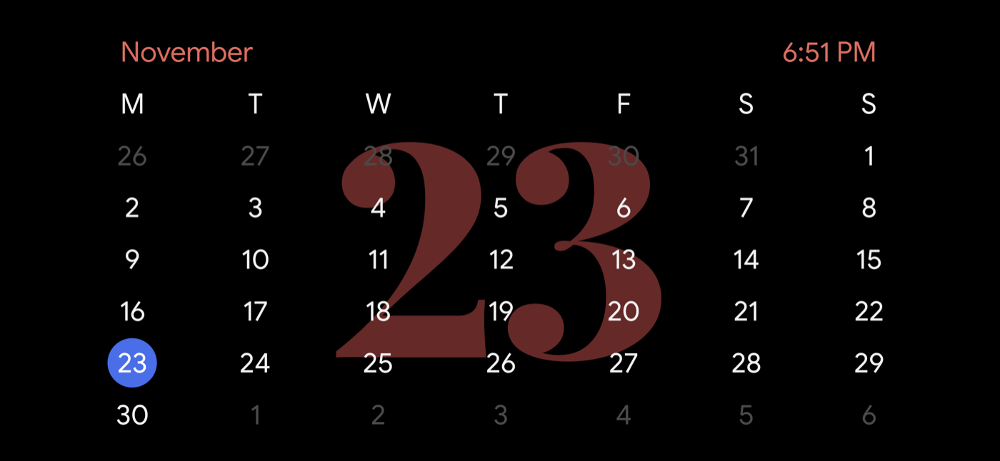
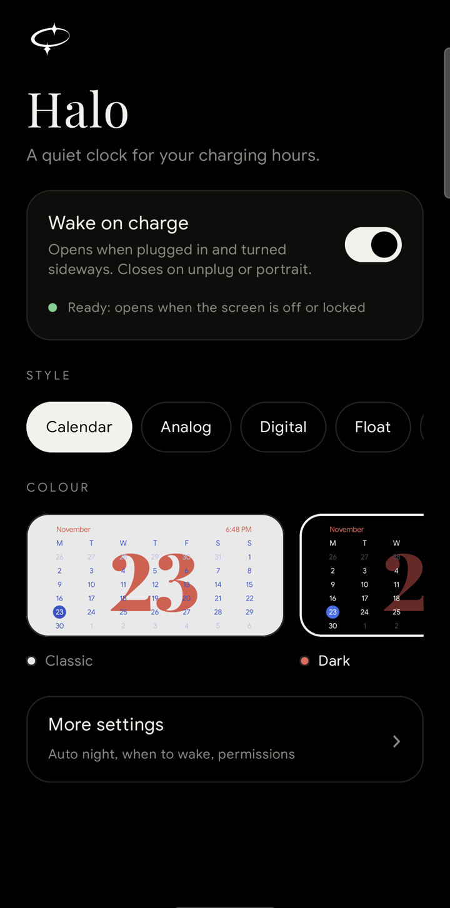
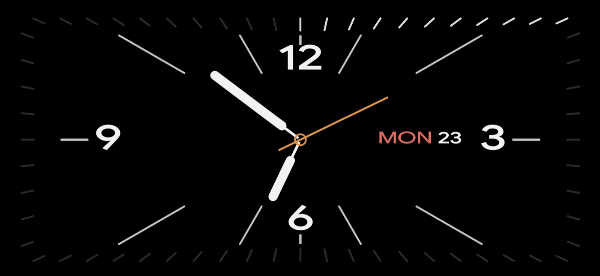
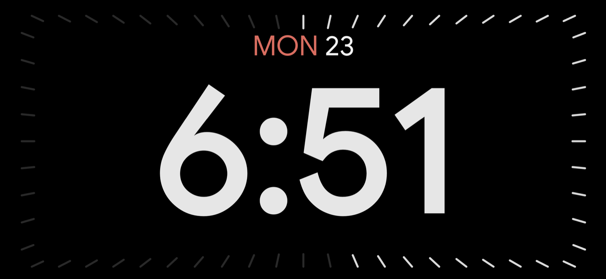
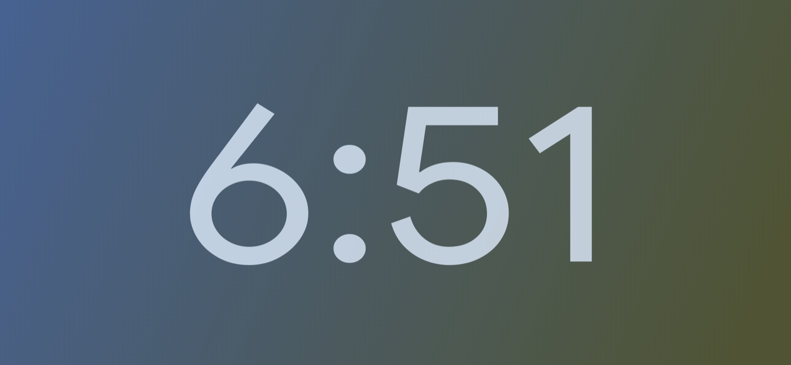
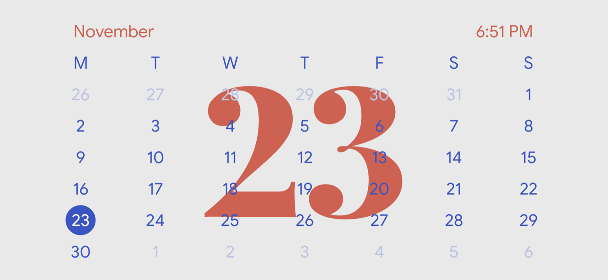
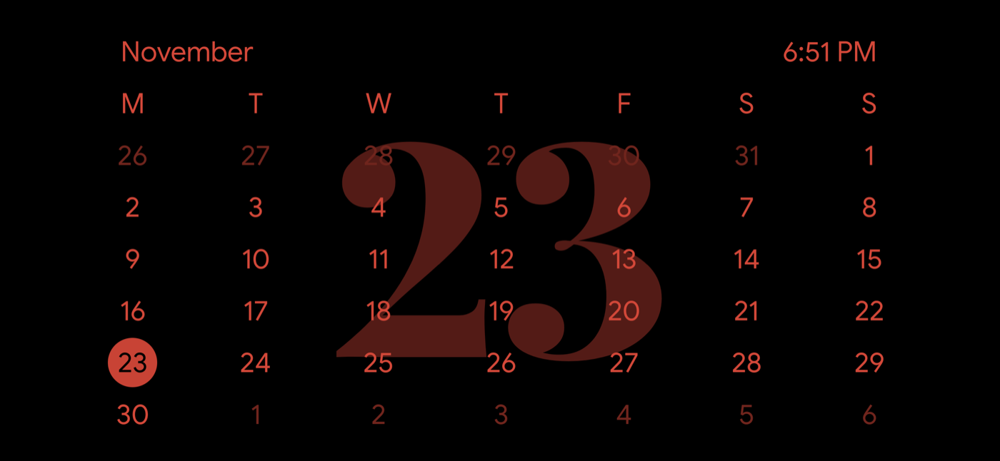
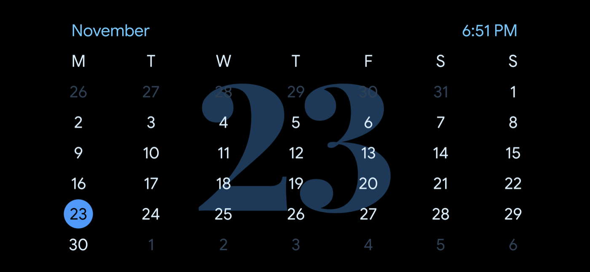
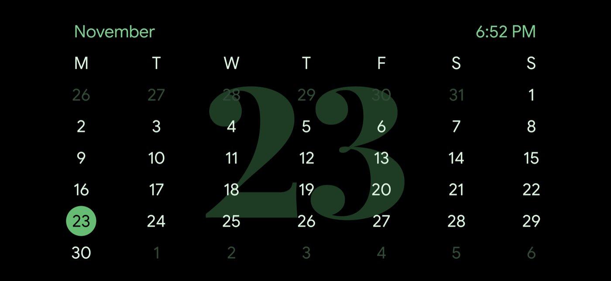
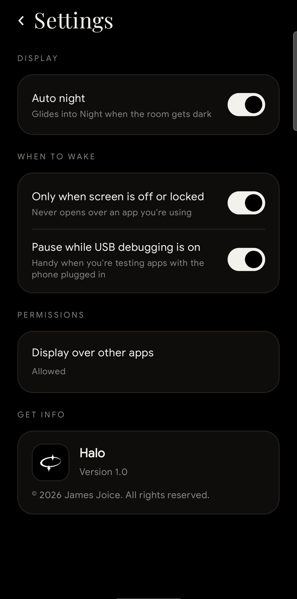

# Halo

*A quiet clock for your charging hours.*

Halo turns your Android phone into a calm bedside or desk display, in the spirit of iOS StandBy. Plug the phone in,
turn it sideways, and a full-screen calendar or clock fades in. Turn it upright or unplug it and it goes away.

<table>
  <tr>
    <td></td>
    <td></td>
  </tr>
</table>

## Highlights

- **Six styles**, swipe sideways on the clock to change: Calendar, Analog, Lines, Digital, Float, Agenda.
- **Seven colour themes**, with a live preview of each in the app.
- **Wake on charge**: opens by itself when the phone is charging and turned sideways.
- **Quick Settings tile** for a phone on a stand with no charger: opens when the phone is sideways, ends when it isn't.
- **Works over the lock screen** and wakes the display.
- **Auto night**: glides into the red Night theme when the room gets dark.
- **Stays out of the way**: waits until the phone is still, steps aside for phone calls and Android Auto, and can
  stay off while USB debugging is on or while you are using the phone.
- **OLED friendly**: the picture drifts imperceptibly slowly so no pixel stays lit in the same spot for hours.

## The styles

| Calendar | Analog |
| --- | --- |
|  |  |
| **Lines** | **Digital** |
|  |  |
| **Float** | |
|  | |

- **Calendar**: Monday-first month grid with today circled, a large serif date behind it, the month and the time on
  one line (aligned with the first and last weekday letters).
- **Analog**: a stretched face with thin spokes, a ring of short ticks that lights up with the seconds, thick rounded
  hands and a second hand that glides smoothly.
- **Lines**: the Analog face's ring of short ticks (lighting up with the seconds) around a big digital time, with the
  date above it.
- **Digital**: the time as large as the screen allows (sized to fill the width), on a soft gradient.
- **Float**: chunky rounded digits that overlap, slightly tilted, with no colon. Themes that would look the same in
  Float (Dark, Ocean, Steel) are skipped when you swipe through colours there.
- **Agenda**: a compact analog clock on the left, today's events on the right under a "TODAY" heading with the date (timed events only, up to four, from the phone's
  calendars). Halo asks for read-only calendar access only when you pick Agenda. The events also show on the lock
  screen, so anyone who sees the phone sees today's event titles. The in-app preview uses sample events.

## Colours

Seven themes: **Classic, Forest, Night, Steel, Mist, Ocean, Dark.** (Similar-looking themes are kept apart, so each swipe is a clear change.) Steel is soft light blue on deep
navy and Mist is white on soft grey-green; both look best with Digital. Every theme works with every style.

| Classic | Night | Ocean |
| --- | --- | --- |
|  |  |  |
| **Forest** | | |
|  | | |

## The app

| Home | Settings |
| --- | --- |
|  |  |

The home screen holds what you change often: the Wake on charge switch (with a live status line that says why Halo is
or is not going to open), the style, and the colour. **More settings** holds Auto night, the "when to wake" options,
the permission status and Get info.

## How Halo decides when to open

**Wake on charge** (the switch in the app). Halo opens when **all** of these are true:

1. the phone is charging;
2. it is turned sideways;
3. it has rested **still for about 3 seconds** (holding it sideways in your hands never triggers it);
4. nothing is holding it back: no phone call, no Android Auto, the optional "pause while USB debugging is on" is not
   in effect, and, if "only when screen is off or locked" is on, the screen is off or locked.

It closes when you unplug, turn the phone upright or lay it flat, take a phone call, or start Android Auto. Pressing
Back just closes it, and it will not reopen until you leave the sideways position or unplug.

**Desk session** (the Quick Settings tile). For a phone on a stand with no charger. Tap the tile on, and Halo opens as
soon as the phone is sideways and still, whether it was already sideways when you tapped, or you lock the screen first and
turn it sideways afterwards (it then wakes the screen). It waits up to 30 minutes for that, then switches itself off to
save battery. It ends on its own the moment the phone leaves landscape, or when you press Back, and the tile then shows
Off. It ignores the charger and the screen / USB-debugging options, because you started
it by hand. Calls and Android Auto still close it. It is independent of the Wake on charge switch.

**Auto night.** When the light sensor reads 5 lux or less for 2 seconds (lights off), the screen fades into the Night theme and
dims. It returns to your theme once the light stays above 10 lux for 2 seconds.

**On the clock screen:** swipe sideways to change style, swipe up or down to change the colour theme, tap anywhere to reveal a **Halo settings** button.

## Download and install

Halo is an Android app (Android 8.0 or newer). Get the signed APK from the
[latest release](../../releases/latest).

1. Copy the APK to your phone and open it (allow installs from your browser or file manager if asked).
2. Open Halo and allow **Display over other apps** (the home screen shows an Allow button until you do). Halo needs it
   to open itself.
3. Switch **Wake on charge** on.
4. For the stand mode, add the **Halo** tile to Quick Settings (swipe down twice, tap the pencil, drag Halo in).

Notes:

- Halo runs a small background service so it can watch for charging and orientation. Android requires that service to
  have a notification. Halo never asks for notification permission, so on Android 13 and newer that notification stays
  hidden and everything works normally.
- On Samsung phones, set Halo's battery usage to **Unrestricted** if it ever stops opening.
- Halo has no ads and does not use the internet. Calendar access (Agenda style only) is read-only and stays on the phone. See the [privacy page](PRIVACY.md).
- **Check your download:** each release lists the APK's SHA-256 checksum and the signing certificate fingerprint. Compare them (`shasum -a 256 Halo-1.0.6.apk`) before installing.
- **Found a bug or have an idea?** Open an [issue](../../issues).

## Credits and licences

- Calendar design inspired by **Duo Calendar** by Radoslav Bali. Clock faces inspired by **iOS StandBy**.
- The "Halo" wordmark and the large calendar date are set in **Playfair Display**, under the SIL Open Font License 1.1
  ([`licenses/PlayfairDisplay-OFL.txt`](licenses/PlayfairDisplay-OFL.txt)).

© 2026 James Joice. All rights reserved. See [`LICENSE`](LICENSE). The source code is private.
